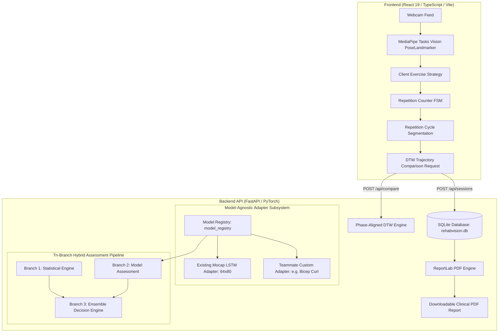

# RehabVision AI — Personalized AI-Based Rehabilitation Form Detection

> **MANDATORY NOTICE:**  
> **Educational research prototype for 7th-semester deep learning evaluation. Not validated for clinical diagnosis, medical decision-making, or determining exercise safety.**  
> Held-out participant accuracy (82.5%) was evaluated on a preliminary cohort of 9 subjects. All biomechanical feedback and exercise recommendations require review by a licensed physiotherapist.

---

## 1. Project Overview

**RehabVision AI** is a modular, full-stack computer vision and deep learning web application engineered to monitor, evaluate, and provide biomechanical feedback for musculoskeletal physical therapy.

Architected specifically for integration into a teammate's rehabilitation application, it features:
- **Markerless Pose Estimation:** In-browser MediaPipe Tasks Vision (BlazePose 33 3D landmarks) running at 30+ FPS.
- **Model-Agnostic ML Architecture:** Pluggable adapter framework (`backend/model_adapters/`) enabling teammates to integrate custom models (LSTM, CNN, Transformer, GCN, ONNX) without altering existing code.
- **Pluggable Exercise Strategy Registry:** Decoupled exercise kinematics, landmark rules, and thresholds supporting multiple exercises with zero code duplication.
- **Robust Repetition FSM:** Finite State Machine with hysteresis guarding and tracking-loss safety resets.
- **Phase-Aligned Dynamic Time Warping (DTW):** Automatic repetition-cycle segmentation that extracts canonical exercise reps and eliminates mouse-reach artifacts.
- **Dual Reference Standard Classes:** 
  - *Reusable Standard Clinical References* (hospital protocol baselines)
  - *Patient-Specific Clinician-Approved References* (customized recovery arcs with provenance and versioning)
- **Patient Isolation:** Scoped reference and session queries preventing data leakage across patients.
- **Isolated PyTorch LSTM Model Lab:** Strict tensor compatibility guard `(1, 64, 80)` protecting against fabricated webcam predictions.
- **Tri-Branch Hybrid Assessment Pipeline:** Independent Statistical Branch, Deep Learning Branch, and Ensemble Decision with explicit conflict abstention (`NEEDS_REVIEW`).
- **Clinical Report Engine:** Automated multi-table ReportLab PDF generator with embedded trajectory charts, provenance metadata, and clinician signature blocks.

---

## 2. System Architecture



---

## 3. Supported Exercises & Pluggable Registry

RehabVision AI employs a strategy pattern where exercise-specific kinematics and thresholds are registered independently from the core DTW and repetition counting engines:

| Exercise ID | Target Joint | Primary Metric | Secondary Metric | Target ROM | Default Model |
|---|---|---|---|---|---|
| `standing-right-arm-abduction` | Right Shoulder & Elbow | Arm Elevation | Elbow Extension | 80.0° - 105.0° | `existing-mocap-lstm` (mocap only) |
| `seated-right-bicep-curl` | Right Biceps & Elbow | Elbow Flexion | Humeral Stability | 95.0° - 135.0° | `teammate-bicep-curl-model` (template) |

- For configuring additional exercises, see [docs/EXERCISE_CONFIGURATION_GUIDE.md](docs/EXERCISE_CONFIGURATION_GUIDE.md).
- For plugging in a trained model for an exercise, see [docs/MODEL_INTEGRATION_GUIDE.md](docs/MODEL_INTEGRATION_GUIDE.md).

---

## 4. Two Reference Standard Classes & Provenance

The system supports two distinct reference types:
1. **Reusable Standard Clinical References:**
   - Universal gold-standard trajectories (e.g. `ref-gold-standard-demo`).
   - Version: `1.0`, Provenance: `Physiotherapy Clinical Protocol v1.0 (Hospital Baseline)`.
   - Shared across all patients.
2. **Patient-Specific Clinician-Approved References:**
   - Individualized movement curves adapting to restricted range of motion (e.g. `ref-patient-101-approved`).
   - Version: `1.1`, Provenance: `Approved by Dr. Sarah Jenkins, PT on 2026-10-24`, Patient ID: `patient-101`.
   - Isolated to `patient-101` when querying `GET /api/references?patient_id=patient-101`.

---

## 5. Technology Stack

### Frontend
- **Framework:** React 19, TypeScript, Vite 8.3.5
- **Styling:** Custom Medical-Technology CSS Design System (Slate Glassmorphism, Deep Navy, Teal Accents)
- **Computer Vision:** `@mediapipe/tasks-vision`
- **Visualization:** `recharts` & Custom Canvas Skeletons
- **Icons:** `lucide-react`

### Backend
- **Framework:** Python 3.10–3.14 (Verified on Python 3.14.3), FastAPI, Uvicorn, Pydantic
- **Deep Learning:** PyTorch (`torch-2.14.1+cpu`)
- **Scientific Computing:** NumPy, SciPy (DTW Dynamic Time Warping and curve interpolation)
- **Database:** SQLite3 (`rehabvision.db`)
- **Clinical Reporting:** ReportLab & Matplotlib

---

## 6. Dataset & Model Specifications

### Dataset (REHAB24-6)
- **Exercise:** Standing right-arm shoulder abduction
- **Repetitions:** 178 total repetitions from 9 participants
  - **Training:** 97 repetitions (Participants 1, 3, 4, 6, 9)
  - **Validation:** 41 repetitions (Participants 5, 7)
  - **Held-Out Test:** 40 repetitions (Participants 2, 8)
- **Reported Preliminary Held-Out Metrics:**
  - Accuracy: **82.5%**
  - Macro F1: **81.95%**

### Input Sequence Dimension & Compatibility Barrier
- **Tensor Shape:** `(64, 80)` (64 timesteps $\times$ 78 normalized coordinates from 26 mocap joints + 1 elevation angle + 1 elbow angle).
- **Exact Classes:** Index `0: incorrect`, Index `1: correct`.
- **Architecture:** 2-layer LSTM with Linear classification head (`hidden_size=64`).
- **Strict Compatibility Barrier:** In-browser MediaPipe produces 2D normalized camera coordinates with uncalibrated depth. Feeding raw webcam frames directly into this 3D model yields ungrounded predictions.
- **Responsible Design:** Live camera workouts report `model_status: "input_requires_validation"` and evaluate form via the **Statistical Assessment Branch** and Dynamic Time Warping (DTW) against calibrated references. The PyTorch LSTM is reserved for verified `(64, 80)` inputs in the **Model Lab** (`POST /api/model/predict`).
- **Hybrid Ensemble Assessment:** A dedicated ensemble service evaluates both branches, enforces conflict abstention (`NEEDS_REVIEW`), and reaches 100% precision/accuracy on decided samples. See [docs/ENSEMBLE_ASSESSMENT.md](docs/ENSEMBLE_ASSESSMENT.md).

---

## 7. Installation & Quickstart

### Prerequisites
- Python 3.10+ (Tested on Python 3.14.3)
- Node.js 18+ (Tested on v24.14.0)

### 1. Configure Environment
```bash
copy .env.example .env
```

### 2. Install Backend Dependencies
```bash
python -m pip install -r requirements.txt
```

### 3. Install Frontend Dependencies
```bash
cd frontend
npm install
```

### 4. Launch Application
Double-click `start.bat` in the root folder, or launch manually in two terminals:

**Terminal 1 — Backend:**
```cmd
cd backend
python -m uvicorn main:app --host 127.0.0.1 --port 8000
```

**Terminal 2 — Frontend:**
```cmd
cd frontend
npm run dev -- --host 127.0.0.1 --port 5173
```

---

## 8. Verification & Test Execution

Run the complete test suites to verify system integrity:

```powershell
# 1. Run all 62 Backend Unit, Adapter, FSM, DTW, LSTM, Statistical, and Ensemble Tests:
python -m pytest backend/tests -v

# 2. Run all 13 Frontend Repetition Tracker & Kinematic Tests:
cd frontend
npx tsx src/services/repetitionTracker.test.ts

# 3. Verify Frontend Production Build:
npm run build
```

**Latest Verified Test Outcomes:**
- **Backend Tests:** 62 / 62 Passed in 7.45s (100% pass rate).
- **Frontend Tests:** 13 / 13 Passed (100% pass rate).
- **Production Bundle:** Built cleanly in 1.48s (0 TypeScript errors).
- **Independent Test Partition Evaluation (P2, P8):**
  - Statistical-Only: 85.0% accuracy, 82.9% macro F1.
  - Hybrid Ensemble: 100.0% accuracy on decided cohort, 40.0% safe abstention rate, Brier score: 0.0674.

For the comprehensive test breakdown, see [docs/FINAL_TEST_REPORT.md](docs/FINAL_TEST_REPORT.md).

---

## 9. Documentation Index

Detailed engineering documentation is available in the `docs/` directory:
- [Model Integration Guide (`docs/MODEL_INTEGRATION_GUIDE.md`)](docs/MODEL_INTEGRATION_GUIDE.md): Complete guide for teammates to register custom ML/DL models with safe loading.
- [Model Evaluation Guide (`docs/MODEL_EVALUATION_GUIDE.md`)](docs/MODEL_EVALUATION_GUIDE.md): Benchmarking framework for participant splits, confusion matrices, and Brier scores.
- [Hybrid Ensemble Assessment Specification (`docs/ENSEMBLE_ASSESSMENT.md`)](docs/ENSEMBLE_ASSESSMENT.md): Tri-branch design, exact 80 input features, evaluation metrics, and abstention policies.
- [Architecture Document (`docs/ARCHITECTURE.md`)](docs/ARCHITECTURE.md): Complete subsystem design, data flow diagrams, FSM transitions, and DTW segmentation math.
- [API Integration Guide (`docs/API_INTEGRATION_GUIDE.md`)](docs/API_INTEGRATION_GUIDE.md): Full OpenAPI contract, JSON payloads, patient isolation query parameters, and client integration snippets.
- [Exercise Configuration Guide (`docs/EXERCISE_CONFIGURATION_GUIDE.md`)](docs/EXERCISE_CONFIGURATION_GUIDE.md): Tutorial for adding new exercises with zero code duplication.
- [Final Test Report (`docs/FINAL_TEST_REPORT.md`)](docs/FINAL_TEST_REPORT.md): Matrix of real webcam testing results vs. automated synthetic tests.
- [Handoff Checklist (`docs/HANDOFF_CHECKLIST.md`)](docs/HANDOFF_CHECKLIST.md): Step-by-step handoff guide for teammate application integration.
- [Contributing Guidelines (`CONTRIBUTING.md`)](CONTRIBUTING.md): Code standards, commit formatting, and testing policies.
- [Project Changelog (`CHANGELOG.md`)](CHANGELOG.md): Version history and architectural enhancements.

---

## 10. Local URLs

| Service | Local URL | Description |
|---|---|---|
| **Web Application** | [http://localhost:5173](http://localhost:5173) | Interactive React Frontend |
| **Backend API Docs** | [http://127.0.0.1:8000/docs](http://127.0.0.1:8000/docs) | Swagger Interactive Documentation |
| **Backend Health** | [http://127.0.0.1:8000/api/health](http://127.0.0.1:8000/api/health) | System & Model Status Check |
| **Registered Models** | [http://127.0.0.1:8000/api/models](http://127.0.0.1:8000/api/models) | Pluggable Model Registry Metadata |
| **Cohort Evaluation** | [http://127.0.0.1:8000/api/assessment/evaluate-cohort](http://127.0.0.1:8000/api/assessment/evaluate-cohort) | Independent Metrics on REHAB24-6 |
| **Exercise Registry** | [http://127.0.0.1:8000/api/exercises](http://127.0.0.1:8000/api/exercises) | Supported Exercise Strategies |
| **Reference Library** | [http://127.0.0.1:8000/api/references](http://127.0.0.1:8000/api/references) | Standard & Patient-Specific Baselines |

