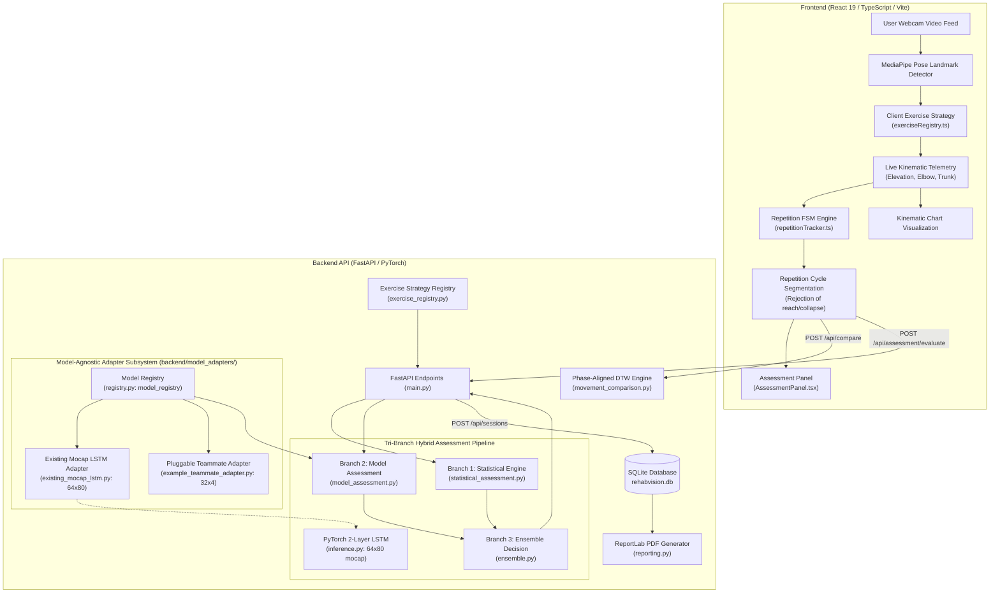
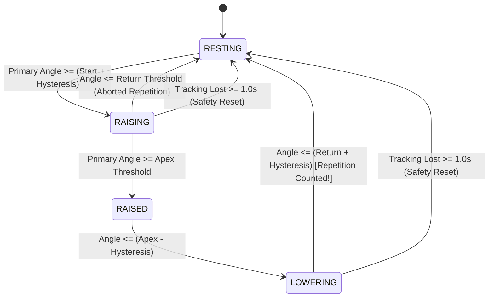

# RehabVision AI — System Architecture Document

## 1. Executive Summary & Purpose

**RehabVision AI** is an open, modular computer-vision and deep learning application designed to evaluate patient exercise execution in real time. It was engineered for a 7th-semester deep learning capstone and architected for seamless plug-in integration into a teammate's rehabilitation platform.

### Core Capabilities
1. **Real-Time Markerless Pose Estimation:** High-cadence in-browser landmark detection via MediaPipe Tasks Vision (BlazePose 33 3D landmarks).
2. **Pluggable Exercise Strategy Framework:** Decoupled kinematics, landmark validation, and repetition thresholds via a registry pattern.
3. **Finite State Machine (FSM) Repetition Engine:** Hysteresis-guarded state progression (`RESTING` → `RAISING` → `RAISED` → `LOWERING` → `RESTING`) with tracking-loss fallback timers.
4. **Repetition-Cycle Segmentation & Phase-Aligned DTW:** Dynamic Time Warping alignment applied strictly to segmented exercise cycles, rejecting pre-exercise pauses and post-session mouse-reach artifacts.
5. **Two Reference Standard Classes:** Support for *Reusable Standard Clinical References* (hospital protocols) and *Patient-Specific Clinician-Approved References* (tailored recovery arcs with provenance).
6. **Isolated PyTorch LSTM Model Lab:** A strict input-compatibility barrier enforcing verified (64, 80) motion-capture coordinate inputs, guarding against spurious predictions from mismatched webcams.
7. **Clinical Report Generation:** Automated ReportLab PDF generator rendering session metadata, biomechanical kinematics, DTW deviation matrices, and provenance signatures.

---

## 2. High-Level System Architecture



---

## 3. Subsystem Breakdown

### 3.1 Landmark Detection & Tracking Validity Barrier
- **MediaPipe Pose Integration:** In-browser WebAssembly extraction running at 30+ FPS.
- **Robustness Decoupling:** In earlier iterations, right-wrist occlusion (common when the user lifts their hand near the camera edge) erroneously marked the entire shoulder elevation as "LOST". The architecture now decouples joint prerequisites:
  - **Shoulder Elevation Prerequisite:** Right Shoulder (12), Right Elbow (14), and Torso Hip (Right 24 or Left 23 fallback).
  - **Elbow Extension Prerequisite:** Right Wrist (16). If the wrist is occluded, shoulder elevation tracking continues unhindered; only elbow angle is flagged as degraded.
  - **Presence Score Metric:** `getLandmarkScore(lm)` computes `min(visibility, presence)` evaluated against a lenient `0.30` threshold.

### 3.2 Finite State Machine (FSM) Repetition Tracking
The repetition counter enforces strict biomechanical milestones:



- **Hysteresis Guard:** Default ±5.0° prevents noisy landmark jitter from triggering false state transitions.
- **Confirmation Filter:** Requires 2 consecutive frames satisfying transition criteria before changing state.
- **Tracking-Loss Safe Reset:** If tracking drops for more than 1.0s during an active movement, the FSM safely resets to `RESTING` without counting an invalid rep.

### 3.3 Movement Comparison & Canonical Cycle Segmentation
When a patient completes a workout consisting of $N$ repetitions, naive end-to-end DTW against a 1-repetition reference produces massive artificial phase distortion and penalizes repetitions based on post-exercise button clicks.

**Our Phase-Alignment Solution:**
1. **Repetition Cycle Extraction:** `segment_repetition_cycles(home_angles)` identifies individual movement arcs from valley to valley.
2. **Canonical Cycle Selection:** Finds the cleanest repetition closest to the median peak angle, filtering out reach/collapse artifacts where the user reached forward to press the stop button.
3. **Resampling:** Both the reference and patient canonical cycles are uniformly resampled to 64 equidistant timesteps.
4. **Dynamic Time Warping (DTW):** Fast Euclidean distance matrix alignment computes optimal warping paths:
   $$\text{Similarity Index} = \max\left(0, 100 \times \left(1.0 - \frac{\text{Mean Elevation Deviation}}{45.0}\right)\right)$$

### 3.4 Dual Reference Standard Framework
The system implements two distinct reference standard categories:
1. **Reusable Standard Clinical References:**
   - Universal gold-standard movement trajectories established by clinical protocol.
   - Example: `ref-gold-standard-demo` (Version: `1.0`, Provenance: `Physiotherapy Clinical Protocol v1.0`).
   - Available to all patients as a baseline comparison.
2. **Patient-Specific Clinician-Approved References:**
   - Customized movement references recorded by or for a specific patient, adapting to restricted functional range of motion (e.g. rotator cuff repair limited to 85° elevation).
   - Tagged with `patient_id`, `version`, and clinician approval `provenance`.
   - Example: `ref-patient-101-approved` (Version: `1.1`, Provenance: `Approved by Dr. Sarah Jenkins, PT on 2026-10-24`).
   - Querying with `?patient_id=patient-101` provides complete reference isolation (only returning `patient-101`'s references alongside global standards, strictly preventing leakage across patients).

### 3.5 Pluggable Exercise Strategy Architecture
All exercise-specific parameters are encapsulated in the `ExerciseStrategy` interface:

| Strategy Property | Standing Right-Arm Abduction | Seated Right Bicep Curl |
|---|---|---|
| **Exercise ID** | `standing-right-arm-abduction` | `seated-right-bicep-curl` |
| **Target Joints** | Right Shoulder & Elbow | Right Biceps Brachii & Elbow |
| **Primary Metric** | Arm Elevation (from vertical torso) | Elbow Flexion (180° - elbow angle) |
| **Secondary Metric** | Elbow Extension | Humeral Stability / Shoulder Sway |
| **Target Active ROM**| 80.0° - 105.0° | 95.0° - 135.0° |
| **FSM Start Thresh** | 30.0° elevation | 35.0° flexion |
| **FSM Apex Thresh**  | 80.0° elevation | 110.0° flexion |
| **FSM Return Thresh**| 25.0° elevation | 25.0° flexion |
| **Required Landmarks**| 12 (R.Shoulder), 14 (R.Elbow), 24/23 (Hip) | 12 (R.Shoulder), 14 (R.Elbow), 16 (R.Wrist) |

### 3.6 PyTorch Deep Learning Model Lab & Compatibility Barrier
- **Model Architecture:** 2-layer Bidirectional LSTM (hidden size 64) with Dropout (0.3) and Linear classifier.
- **Trained Artifacts:** Trained on REHAB24-6 motion-capture repetitions (178 sequences across 9 subjects; reported held-out accuracy 82.5%, macro F1 81.95%).
- **Strict Compatibility Barrier:** The LSTM strictly expects input tensors of shape `(1, 64, 80)` containing 78 normalized coordinates from 26 mocap markers, 1 arm elevation angle, and 1 trunk lean angle.
- **Anti-Spurious Prediction Guarantee:** Webcams provide 2D image coordinates with uncalibrated depth ($Z$). Mapping arbitrary webcam feeds into this LSTM without spatial calibration yields fabricated, unscientific predictions. Therefore, live camera workouts mark `model_status: "input_requires_validation"`. The genuine LSTM is exposed via `/api/model/predict` for verified compatible motion-capture inputs.

### 3.7 Model-Agnostic Adapter Subsystem (`backend/model_adapters/`)
To support diverse model architectures (LSTM, CNN, Transformer, GCN, ONNX) developed by teammates for different exercises, RehabVision AI implements a model-agnostic adapter framework:
- **`BaseModelAdapter` (`backend/model_adapters/base.py`):** Abstract base class declaring the standard contract:
  - `get_metadata()`: Returns unique model ID, version, supported exercise IDs, expected input shape, feature ordering, coordinate systems, and operational status.
  - `validate_input(sequence, exercise_id)`: Enforces exact shape and numerical checks before inference.
  - `preprocess(sequence)`: Performs adapter-specific feature normalization (e.g., stationary coordinate clamping or z-score standardization).
  - `predict(sequence)`: Generates typed `ModelPredictionResult` with mapped class indices, calibrated probabilities, and confidence scores.
  - `health_check()`: Verifies weights exist, tensor libraries are available, and hardware devices are ready.
- **`ModelRegistry` (`backend/model_adapters/registry.py`):** Singleton registry managing registered adapters with O(1) lookup by `model_id` or default lookup by `exercise_id`.
- **Decoupled Architecture:**
  - `standing-right-arm-abduction` maps to `ExistingMocapLSTMAdapter`.
  - `seated-right-bicep-curl` maps to `ExampleTeammateAdapter` (template ready for teammate's trained weights).
  - Exercises without a registered model gracefully fall back to **Statistical-Only Assessment** with `NEEDS_REVIEW` safeguards.


---

## 4. Database Schema Design (SQLite)

```sql
-- 1. Exercise Definitions Table
CREATE TABLE exercises (
    id TEXT PRIMARY KEY,
    name TEXT NOT NULL,
    target_joint TEXT NOT NULL,
    description TEXT,
    target_rom_min REAL,
    target_rom_max REAL,
    created_at TEXT NOT NULL
);

-- 2. References Library Table (Supporting Dual Reference Types & Provenance)
CREATE TABLE references_table (
    id TEXT PRIMARY KEY,
    exercise_id TEXT NOT NULL,
    exercise_name TEXT NOT NULL,
    notes TEXT,
    duration_seconds REAL NOT NULL,
    frame_count INTEGER NOT NULL,
    joint_angles TEXT NOT NULL,        -- JSON array of AnglePoint
    landmarks_summary TEXT NOT NULL,   -- JSON object of summary stats
    created_at TEXT NOT NULL,
    is_demo INTEGER DEFAULT 0,
    reference_type TEXT DEFAULT 'standard', -- 'standard' | 'patient_specific'
    version TEXT DEFAULT '1.0',
    provenance TEXT DEFAULT 'Clinical Protocol Baseline',
    patient_id TEXT DEFAULT NULL,      -- Isolation tag for patient references
    is_active INTEGER DEFAULT 1
);

-- 3. Patient Workout Sessions Table
CREATE TABLE sessions (
    id TEXT PRIMARY KEY,
    timestamp TEXT NOT NULL,
    exercise_id TEXT NOT NULL,
    exercise_name TEXT NOT NULL,
    reference_id TEXT,
    reference_type TEXT DEFAULT 'standard',
    reference_version TEXT DEFAULT '1.0',
    reference_provenance TEXT DEFAULT NULL,
    patient_id TEXT DEFAULT NULL,
    repetitions_completed INTEGER NOT NULL,
    duration_seconds REAL NOT NULL,
    angle_stats TEXT NOT NULL,         -- JSON object of AngleStats
    comparison_score REAL,
    joint_deviations TEXT NOT NULL,    -- JSON object of JointDeviations
    model_status TEXT NOT NULL,
    lstm_prediction TEXT,              -- JSON object of LSTMPrediction (if mocap)
    statistical_assessment TEXT,       -- JSON object of StatisticalAssessmentResult
    model_assessment TEXT,             -- JSON object of ModelAssessmentResult
    ensemble_decision TEXT,            -- JSON object of EnsembleDecisionResult
    warnings TEXT NOT NULL,            -- JSON array of string warnings
    notes TEXT,
    raw_trajectory TEXT,               -- JSON array of captured AnglePoints
    is_demo INTEGER DEFAULT 0
);
```

---

## 5. Security, Isolation, & Clinical Boundaries

1. **Patient Data Isolation:** Endpoints accepting `?patient_id=<id>` strictly scope sessions and references to that specific patient plus general hospital standards. References belonging to other patients are excluded at the SQL level.
2. **Clinical Disclaimers:** All API responses, PDF reports, and web interfaces include mandatory educational research notices stating that metrics are for engineering prototype evaluation and must not be used for unassisted medical diagnosis.
3. **Graceful Degradation:** If the backend server is temporarily unreachable, the frontend retains local tracking telemetry and presents descriptive error toasts rather than crashing.
